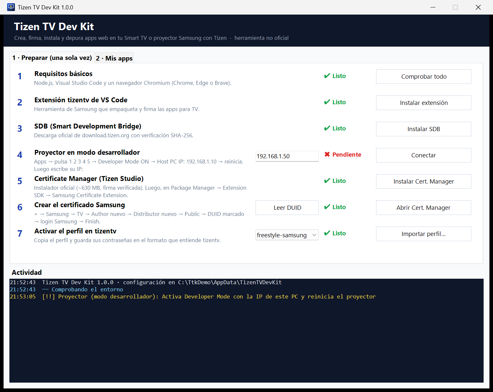
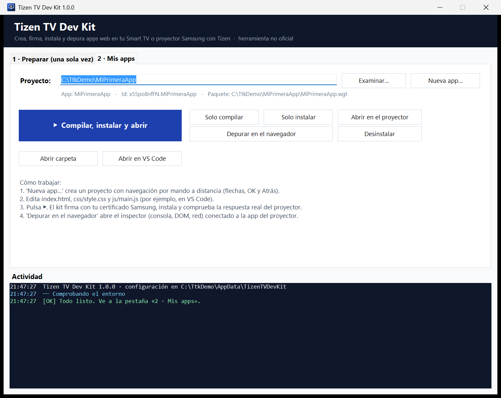

# Tizen TV Dev Kit

**Crea, firma, instala y depura apps web en tu Smart TV o proyector Samsung (Tizen) desde Windows, con un asistente y un botón.**

Herramienta gratuita y de código abierto. **No oficial**: no está afiliada a Samsung. «Samsung» y «Tizen» son marcas de sus titulares.



## Qué hace

Automatiza todo el proceso que normalmente requiere horas de documentación dispersa:

| Paso | El kit lo hace por ti |
|---|---|
| Requisitos | Comprueba Node.js, VS Code, navegador, extensión `tizentv`, SDB, Certificate Manager, perfil y conexión |
| SDB | Lo descarga del repositorio oficial de Tizen y **verifica su SHA-256** |
| Certificate Manager | Descarga el instalador oficial y **verifica la firma digital de Samsung** antes de abrirlo |
| Proyector | Conecta por SDB, muestra plataforma/CPU/versión y lee el **DUID** (lo copia al portapapeles) |
| Certificado Samsung | Abre el Certificate Manager con el DUID detectable y te guía en el asistente |
| Perfil | Importa el perfil a `tizentv` y **re-cifra las contraseñas** en su formato (corrige el error `PKCS#12 MAC could not be verified`) |
| Apps | Crea un proyecto con navegación por mando, compila y firma, instala **comprobando la respuesta real** del dispositivo, abre y depura |

Probado con un proyector **Samsung The Freestyle 2.ª gen (Tizen 9.0)**. Debería funcionar con Smart TV Samsung con Tizen en modo desarrollador.

## Requisitos

- Windows 10/11 (PowerShell 5.1, incluido en Windows).
- [Node.js](https://nodejs.org) LTS y [Visual Studio Code](https://code.visualstudio.com).
- Un navegador Chromium (Chrome, Edge o Brave) para depurar.
- Cuenta de Samsung (para el certificado de distribuidor).
- PC y TV/proyector en la misma red.

El kit **no incluye** binarios de Samsung: los descarga de las fuentes oficiales y verifica su integridad.

## Uso

1. Descomprime el ZIP en una carpeta (por ejemplo `C:\TizenTVDevKit`).
2. Doble clic en **`Iniciar.bat`**.
3. Pestaña **1 · Preparar**: sigue los 7 pasos hasta que todos estén en «✔ Listo».
4. Pestaña **2 · Mis apps**: «Nueva app…» y luego **▶ Compilar, instalar y abrir**.



### Pasos físicos en la TV/proyector

Apps → pulsa **1 2 3 4 5** con el mando → **Developer Mode: ON** → **Host PC IP** = la IP de tu PC (el kit te la muestra) → reinicia.

### Crear el certificado Samsung (paso 6)

En el Certificate Manager: **+** → **Samsung** → **TV** → nombre del perfil → **Author** nuevo → **Create a new distributor certificate** → **Privilege: Public** → contraseña → **Add individual DUIDs** (el DUID aparece marcado) → inicio de sesión de Samsung → **Finish**. Después, en el kit, **Importar perfil…**.

## Línea de comandos

```powershell
.\ttk.ps1 doctor
.\ttk.ps1 conectar 192.168.1.50
.\ttk.ps1 nuevo MiApp
.\ttk.ps1 todo                # compila, instala y abre
.\ttk.ps1 depurar
.\ttk.ps1 ayuda               # todos los comandos
```

## Seguridad y privacidad

- Las contraseñas se piden en cuadros protegidos y no se guardan en claro; se cifran con la herramienta oficial de `tizentv`.
- El kit se niega a empaquetar si encuentra claves privadas (`.p12`, `.pwd`) dentro del proyecto.
- La configuración (IP, rutas) se guarda solo en `%APPDATA%\TizenTVDevKit\config.json`.
- No envía datos a ningún servidor propio; solo contacta con `download.tizen.org`, tu dispositivo y los servicios de Samsung que abre el Certificate Manager.

## Problemas frecuentes

| Mensaje | Solución |
|---|---|
| «El proyector rechazó la instalación… certificado» | Usa un perfil **Samsung** (no el genérico de Tizen) con el DUID correcto |
| «Contraseña del certificado no válida para tizentv» | Repite «Importar perfil…» |
| «No conecta» | Developer Mode activo, Host PC IP correcta, proyector reiniciado, misma red |
| El Certificate Manager no abre | Reinstala desde el Package Manager de Tizen Studio |

## Licencia

[MIT](LICENSE).
