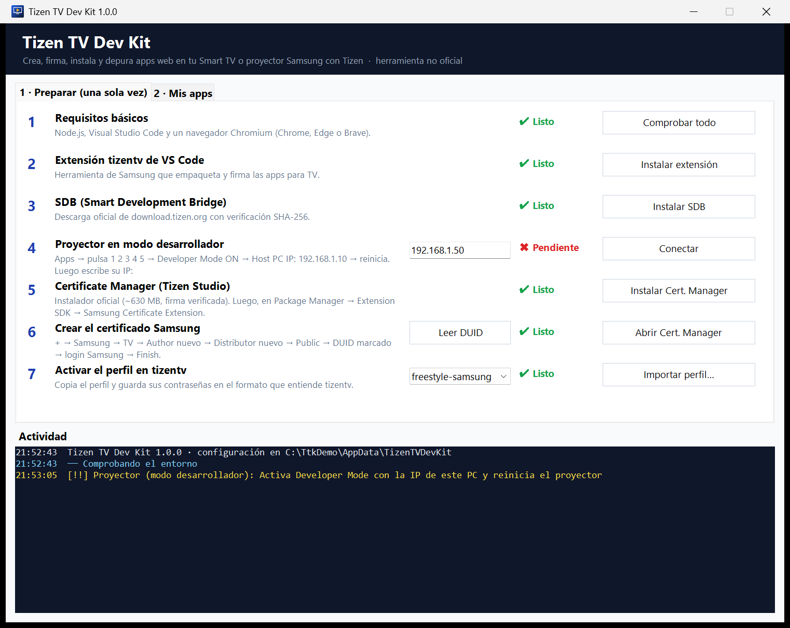
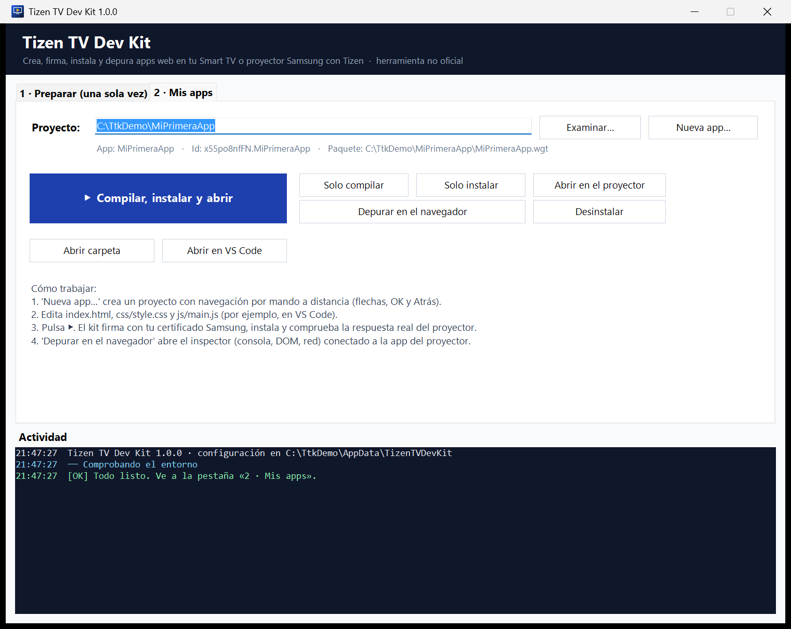

# 07 · Tizen TV Dev Kit: la herramienta que automatiza todo

Las guías anteriores explican el proceso a mano. **Tizen TV Dev Kit** (carpeta [`devkit/`](../devkit)) lo automatiza: un asistente gráfico de 7 pasos y una línea de comandos que comprueban el entorno, instalan lo necesario, conectan el dispositivo, importan el certificado Samsung y compilan, instalan y depuran tus apps con un botón.



## Requisitos

- Windows 10/11 (PowerShell 5.1, ya incluido).
- [Node.js](https://nodejs.org) LTS y [Visual Studio Code](https://code.visualstudio.com).
- Un navegador Chromium (Chrome, Edge o Brave) para depurar.
- Cuenta de Samsung y un dispositivo Samsung con Tizen en modo desarrollador ([02](02-modo-desarrollador.md)).
- PC y dispositivo en la misma red.

## Instalación

**Opción A, el ZIP:** descarga `TizenTVDevKit-1.0.0-windows.zip` desde [Releases](../../../releases), descomprímelo (por ejemplo en `C:\TizenTVDevKit`) y abre `Iniciar.bat`.

**Opción B, el código:** clona el repositorio y abre `devkit\Iniciar.bat`.

> Si Windows SmartScreen avisa, es porque los scripts no están firmados digitalmente. Puedes revisar el código (son archivos de texto) antes de ejecutarlo.

## Uso: pestaña «1 · Preparar» (una sola vez)

Cada paso muestra **✔ Listo** o **✖ Pendiente**. Pulsa **Comprobar todo** en cualquier momento.

| # | Paso | Qué hacer |
|---|---|---|
| 1 | Requisitos básicos | Si falta Node.js, VS Code o un navegador Chromium, instálalos |
| 2 | Extensión tizentv | Botón **Instalar extensión** |
| 3 | SDB | Botón **Instalar SDB** (descarga oficial con SHA-256 verificado) |
| 4 | Proyector | En el dispositivo: Apps → **1 2 3 4 5** → Developer Mode ON → Host PC IP (el kit muestra la de tu PC) → reiniciar. Escribe la IP del dispositivo y pulsa **Conectar** |
| 5 | Certificate Manager | Botón **Instalar Cert. Manager**. Descarga el instalador oficial, verifica la firma de Samsung y lo abre. Instala en una carpeta **nueva** y, en el Package Manager, instala *Samsung Certificate Extension* (pestaña Extension SDK) |
| 6 | Certificado Samsung | **Leer DUID** (lo copia al portapapeles) y **Abrir Cert. Manager**. Sigue [04](04-certificado-samsung.md): **+** → Samsung → TV → Author nuevo → Distributor nuevo → Public → DUID marcado → login Samsung → Finish |
| 7 | Activar perfil | Elige el perfil y pulsa **Importar perfil…**. Escribe las contraseñas de tus certificados (se verifican y se guardan cifradas, nunca en claro) |

Cuando los siete pasos estén en verde, el registro de actividad dice «Todo listo».

## Uso: pestaña «2 · Mis apps»



1. **Nueva app…**: escribe un nombre (letras y números, sin espacios). Crea un proyecto con navegación por mando a distancia (flechas, OK y Atrás).
2. Edita `index.html`, `css/style.css` y `js/main.js` (botón **Abrir en VS Code**).
3. **▶ Compilar, instalar y abrir**: firma con tu perfil Samsung, instala y abre la app. Si el dispositivo rechaza la instalación, el kit lo dice con el motivo.
4. **Depurar en el navegador**: reinstala la app, la abre en modo depuración y lanza el inspector (consola, DOM y red).
5. Botones sueltos: **Solo compilar**, **Solo instalar**, **Abrir en el proyector**, **Desinstalar**.

Para trabajar con un proyecto existente: **Examinar…** y elige la carpeta que contiene `config.xml`.

## Línea de comandos

```powershell
.\ttk.ps1 ayuda                  # lista de comandos
.\ttk.ps1 doctor                 # comprueba el entorno
.\ttk.ps1 instalar-sdb           # descarga SDB verificado
.\ttk.ps1 conectar 192.168.1.50  # conecta y guarda la IP
.\ttk.ps1 info                   # plataforma, CPU, versión de Tizen
.\ttk.ps1 duid                   # DUID del dispositivo
.\ttk.ps1 perfiles               # perfiles del Certificate Manager
.\ttk.ps1 importar-perfil <nombre>
.\ttk.ps1 nuevo MiApp            # proyecto desde la plantilla
.\ttk.ps1 todo                   # compila, instala y abre
.\ttk.ps1 depurar                # instala, abre en depuración y lanza el inspector
.\ttk.ps1 desinstalar
```

Sin argumentos de ruta, los comandos de app usan el proyecto de la carpeta actual o el último utilizado.

## Dónde guarda las cosas

| Qué | Dónde |
|---|---|
| Configuración (IP, rutas, proyecto actual) | `%APPDATA%\TizenTVDevKit\config.json` |
| Instalador descargado de Tizen Studio | `%APPDATA%\TizenTVDevKit\descargas\` |
| SDB | `C:\tizentv-tools\sdb\` |
| Perfil y contraseñas cifradas para `tizentv` | `%USERPROFILE%\tizen-studio-data\vscode-tizentv\resource\` |
| Proyectos nuevos | `%USERPROFILE%\tizen-apps\` (por defecto) |

## Seguridad

- No guarda tu cuenta ni contraseña de Samsung: el inicio de sesión ocurre en el Certificate Manager oficial.
- Las contraseñas de los certificados se piden en cuadros protegidos y se cifran con la herramienta oficial de `tizentv`.
- Se niega a empaquetar si hay `.p12` o `.pwd` dentro del proyecto.
- Solo contacta con `download.tizen.org`, con tu dispositivo y con los servicios que abre el Certificate Manager.

## Problemas frecuentes

| Mensaje | Qué hacer |
|---|---|
| «El proyector rechazó la instalación… certificado» | Usa un perfil **Samsung** (no el genérico) con el DUID de ese dispositivo |
| «Contraseña del certificado no válida para tizentv» | Repite **Importar perfil…** |
| «No conecta» | Developer Mode activo, Host PC IP correcta, reinicia el dispositivo, misma red |
| El Certificate Manager no abre | Reinstala desde el Package Manager; ver [06](06-solucion-de-problemas.md) |

## Alcance

Probado con **Samsung The Freestyle 2.ª gen (Tizen 9.0)**. Herramienta no oficial, no afiliada a Samsung; no incluye software de Samsung (lo descarga de fuentes oficiales y verifica su integridad).
